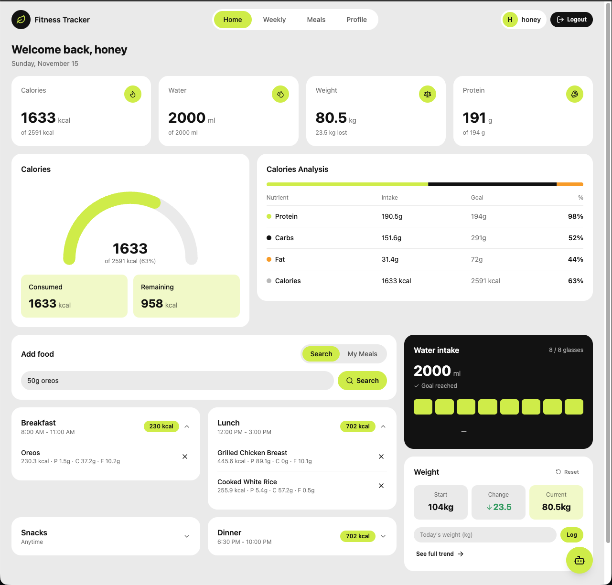
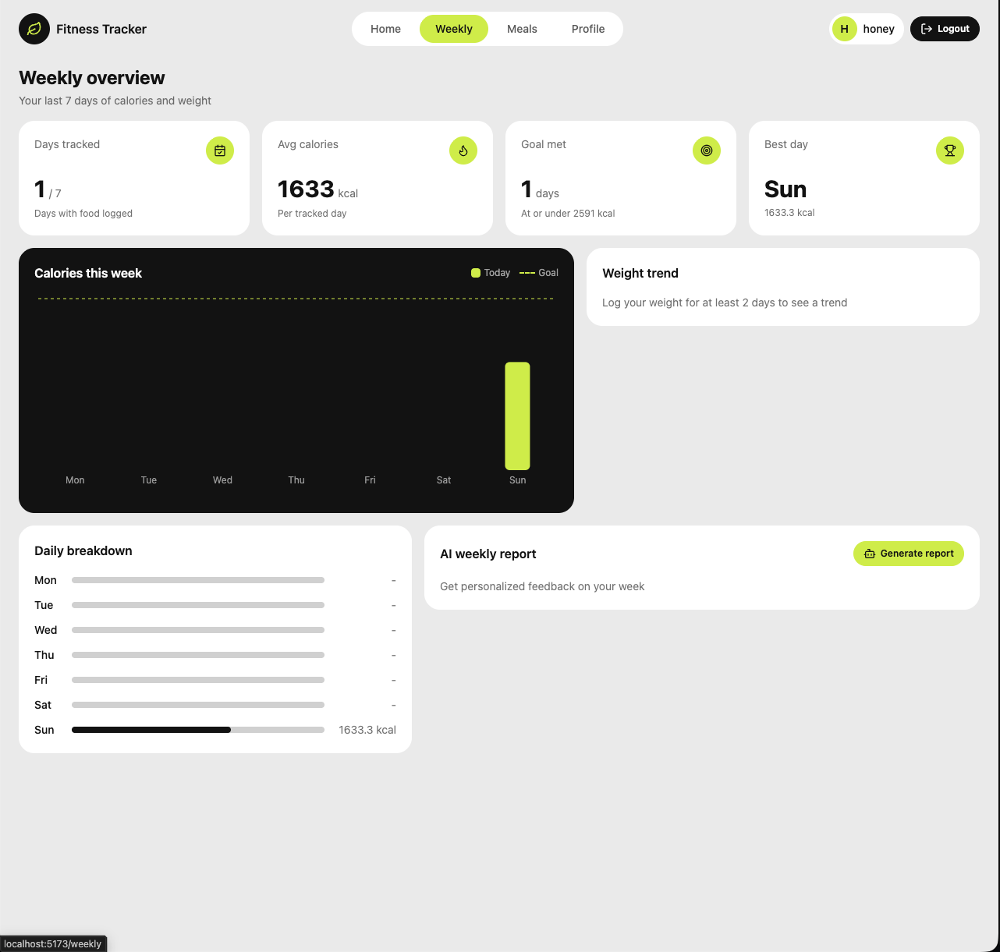
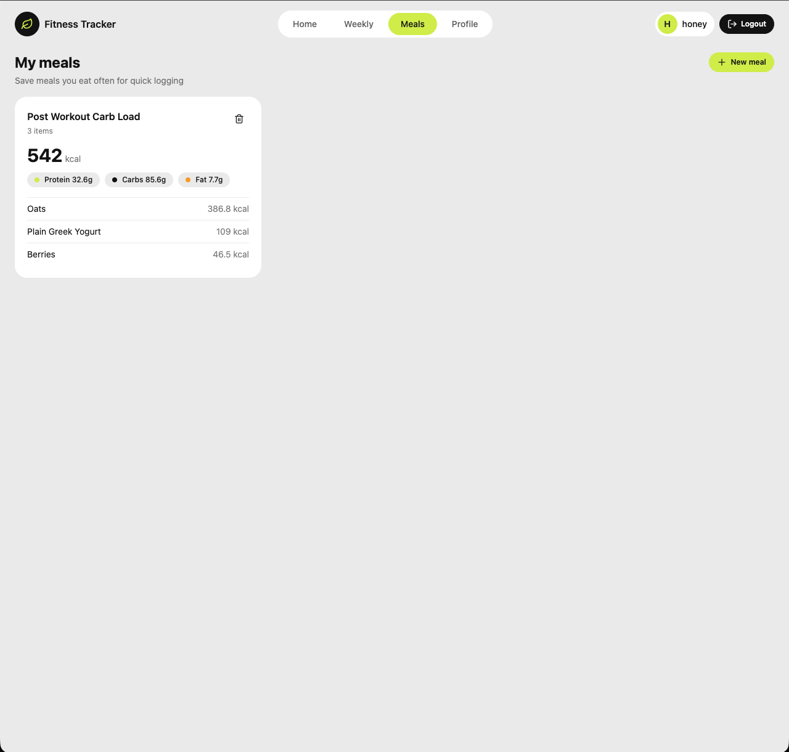
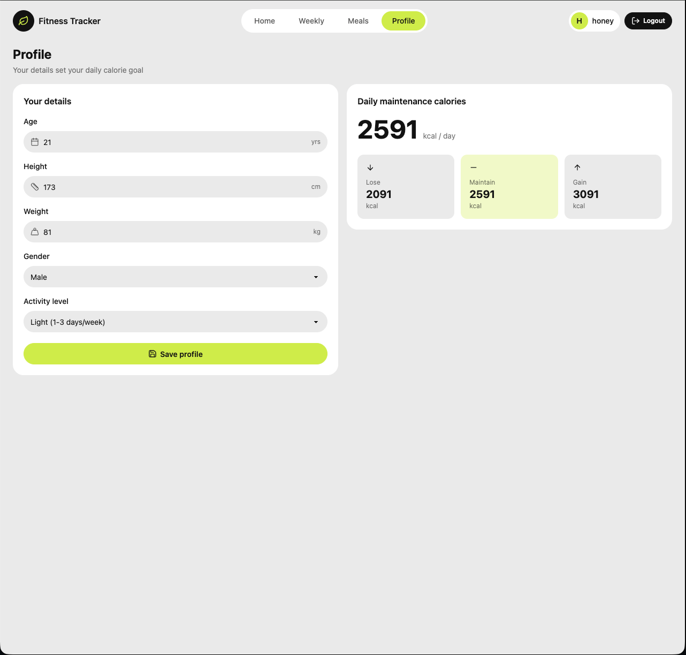
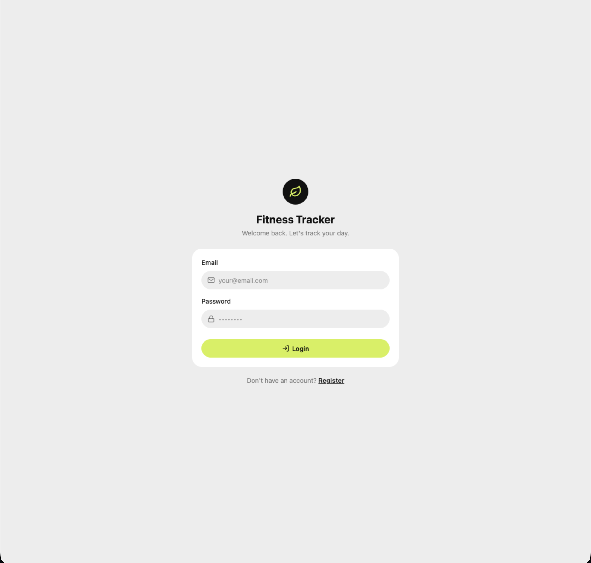

# Fitness Tracker

A full-stack nutrition tracker built with the MERN stack. Search foods in plain language ("2 eggs and 1 cup rice"), log them into meals, track calories, macros, water and weight against a calorie goal calculated from your profile, review your week, and ask an AI coach for advice based on what you actually ate today.

Status: in development.

## Features

- Account registration and login with JWT access and refresh tokens
- Profile with daily calorie goal calculated using the Harris-Benedict equation and activity level
- Natural-language food search backed by the Calorie Ninjas API
- Daily log grouped into breakfast, lunch, snacks and dinner, with calories and macros (protein, carbs, fat)
- Calorie progress bar and macro rings against recommended targets
- Saved meals: build a meal from several foods and log it in one click
- Water tracker (250 ml glasses, daily goal of 8)
- Weight tracker with a starting weight, daily entries and a reset option
- Weekly overview: calorie bar chart with goal line, weight trend line chart, per-day breakdown, summary stats
- AI nutrition coach (Anthropic Claude) in a chat widget, plus an AI weekly report

## Tech stack

| Layer | Tools |
| --- | --- |
| Frontend | React 19, Vite 7, Tailwind CSS 4, DaisyUI 5, React Router 7, Recharts, axios, lucide-react, react-hot-toast |
| Backend | Node.js, Express 5, Mongoose, jsonwebtoken, bcrypt |
| Database | MongoDB (Atlas) |
| External APIs | Calorie Ninjas (nutrition data), Anthropic API (AI coach) |

## Setup

Prerequisites: Node.js, a MongoDB connection string (Atlas free tier works), a Calorie Ninjas API key, an Anthropic API key.

```bash
git clone <repo-url>
cd FitnessTracker

# Backend
cd backend
cp .env.example .env     # fill in the values
npm install
npm run dev              # http://localhost:5001

# Frontend (new terminal)
cd frontend/vite-project
npm install
npm run dev              # http://localhost:5173
```

### Environment variables

`backend/.env`

| Name | Purpose |
| --- | --- |
| `MONGO_URI` | MongoDB connection string |
| `PORT` | Server port (defaults to 5001; Render sets this itself) |
| `ACCESS_TOKEN_SECRET` | Secret for signing access tokens |
| `REFRESH_TOKEN_SECRET` | Secret for signing refresh tokens |
| `CALORIE_NINJAS_API_KEY` | Calorie Ninjas API key |
| `ANTHROPIC_API_KEY` | Anthropic API key |

`frontend/vite-project/.env`

| Name | Purpose |
| --- | --- |
| `VITE_API_URL` | Backend base URL, no trailing slash (defaults to `http://localhost:5001`). Set it in Vercel for production, e.g. the Render URL. |

## Project structure

```
backend/src/
  config/        database connection
  controllers/   request handlers
  middleware/    JWT authentication
  models/        Mongoose schemas
  routes/        Express routers (mounted under /api)
frontend/vite-project/src/
  context/       AuthContext (login state and tokens)
  pages/         Home, Login, Register, Profile, Weekly, Meals
docs/            API reference and design system notes
```

More detail: [docs/API.md](docs/API.md), [docs/DESIGN.md](docs/DESIGN.md).

## Screenshots



| Weekly overview | Meals |
|---|---|
|  |  |

| Profile | Login |
|---|---|
|  |  |
## Live demo

_Add link here._
